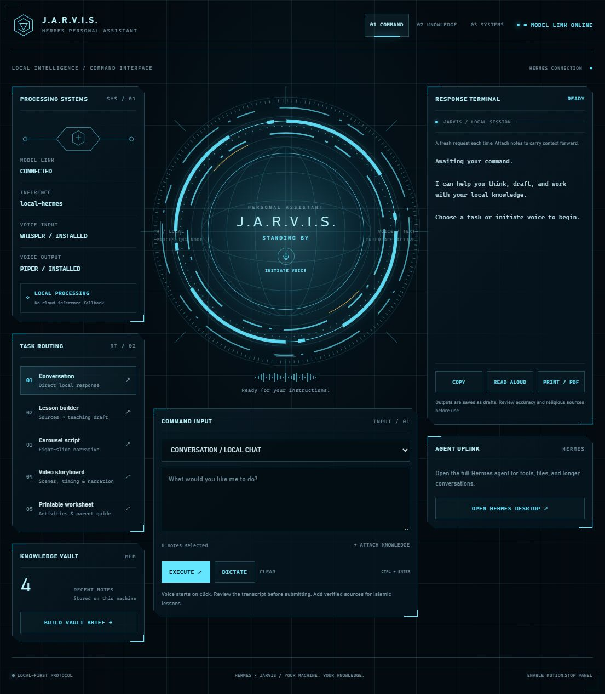

# Hermes Jarvis — local companion workspace

A practical Jarvis-style layer around an existing local Hermes installation: a private Markdown vault, local chat, reusable content workflows, dictation, speech output, and a browser control panel. It builds on Hermes instead of forking its agent core.

**Windows x64 reference build.** Main inference uses an existing llama.cpp server and Agents-A1-4B Q8_0. Voice uses cached Faster-Whisper on CPU and Piper on CPU. The panel serves its own assets from `127.0.0.1`; it does not use hosted fonts, analytics, cloud inference, or browser speech-recognition services.



## What is included

- **Workspace:** stateless local chat, lesson drafts, carousel scripts, children's video storyboards, and worksheet drafts.
- **Knowledge vault:** capture, search and explicitly select Markdown notes; generated results retain the request and input note paths.
- **No-model brief:** a deterministic inventory of your recent saved notes, not fabricated news or a pretend calendar integration.
- **Voice:** explicit push-to-record dictation and on-demand local spoken output. No wake word or background microphone listener.
- **Print:** browser Print / Save as PDF for the opened result, with a separate print stylesheet. This is an export action you perform; the panel does not claim to have created a PDF merely by drafting text.
- **Hermes integration:** a `/jarvis-workspace` skill, a vault map, local routing configuration and an additive SOUL section. Open your existing local Hermes Desktop launcher from the panel for full tool-enabled agent sessions.
- **Reproducibility:** reversible installer, behavior tests, architecture, privacy boundaries and a build journal.

## Start on an existing local Hermes installation

Prerequisites: native Windows Hermes source installation with a working PM-managed Python runtime, local llama.cpp API, and cached Whisper/Piper models. The [local voice guide](https://github.com/owaise-collab/hermes-local-voice-guide) explains that foundation from scratch. This companion does not bundle Hermes, Python environments, model weights or voices.

```powershell
git clone https://github.com/owaise-collab/hermes-jarvis.git
cd hermes-jarvis

# Preview configuration edits without writing user files.
.\scripts\Install-Jarvis.ps1 -DryRun

# Back up and install local routing, the skill, vault map and launcher.
.\scripts\Install-Jarvis.ps1

# Start the panel. Keep its terminal open. Ctrl+C stops it.
.\scripts\Start-Jarvis.ps1
```

Default Hermes home is `$env:HERMES_HOME` or `%LOCALAPPDATA%\hermes`. Use `-HermesHome` and `-HermesSource` for another layout. The installer does not install packages, download models or enable startup tasks. If the home already contains `Start-LocalServer.ps1`, the launcher uses that existing model-server launcher. Otherwise start llama.cpp separately before using model workflows.

For the reference model server, use alias `local-hermes`, loopback port `8080`, and 65,536 context tokens. Supply another local port/model when installing:

```powershell
.\scripts\Install-Jarvis.ps1 -Endpoint 'http://127.0.0.1:8080/v1' -Model 'local-hermes'
.\scripts\Start-Jarvis.ps1 -Port 9120 -NoOpen
```

Open `http://127.0.0.1:9120`. A new `Jarvis-Local.cmd` in the Hermes home provides a double-click launcher. Start a **new Hermes chat** to load the installed skill and SOUL addition. Existing chat prefixes are not rewritten.

## Try one complete workflow

1. In **Knowledge vault**, capture an example/source note. For religious material, include the actual reference and checked quotation; folder names do not mean a source has been approved.
2. Select that note and choose **Use selected notes**.
3. Pick **Prepare a lesson**, supply the age range and learning goal, then create the draft.
4. Review the result, including any source-review markers. It is saved under `jarvis-data/vault/outputs` outside this repository.
5. Select the approved lesson note as context for **Write a carousel**, **Storyboard a children's video**, or **Draft a printable worksheet**.
6. Copy, read aloud, or print the result. Use **Save as PDF** in the print dialog if you want a PDF file.

Dictation only adds a transcript to the input box. Review it and explicitly submit. It never executes voice commands. Open the vault folder in Obsidian using **Open folder as vault**; Obsidian is optional.

## Local means a specific boundary

Panel model calls, selected source text, dictation and speech synthesis stay on this PC. There is no remote fallback. Speech cache misses fail rather than downloading. Saved notes and outputs are plaintext local files. This is not encryption or an OS-wide network sandbox.

Full Hermes agent tools are a different execution surface: web browsing, shell commands, plugins and integrations can use the network. GitHub publishing intentionally uploads reviewed source code and documentation. The public repository excludes user settings, backup manifests, conversations, recordings, notes and model files. Read the full [privacy and security boundaries](docs/03-privacy.md).

## Read the implementation

1. [Architecture and routing](docs/01-architecture.md)
2. [Installation, daily use and rollback](docs/02-operations.md)
3. [Privacy and security](docs/03-privacy.md)
4. [How we built it](docs/04-build-journal.md)
5. [Islamic education and production workflows](docs/05-content-workflows.md)
6. [Verification and known limitations](docs/06-verification.md)

## Run the tests

```powershell
.\scripts\Invoke-HermesPython.ps1 -Script .\tests\test_jarvis.py
.\scripts\Invoke-HermesPython.ps1 -Script .\tests\check_repository.py
```

The behavior suite uses temporary homes and loopback-only test servers; it does not call a live model or open the microphone. Live smoke tests are documented separately and do not imply a fresh-machine certification.

## License and attribution

Original companion code and documentation: MIT, see [LICENSE](LICENSE). Hermes, llama.cpp, Whisper, Piper and all model/voice artifacts retain their respective licenses. See [THIRD_PARTY_NOTICES.md](THIRD_PARTY_NOTICES.md).

Inspired by the workflow and explanatory structure of [Chase AI's component overview](https://www.instagram.com/p/DfKquhHHK3B/) and [five-step workspace post](https://www.instagram.com/chase.h.ai/p/De2OY6tnH8x/). This is an independent implementation, not the author's offered setup or an official Hermes product. We did not copy their dashboard, diagrams or marketing claims.
