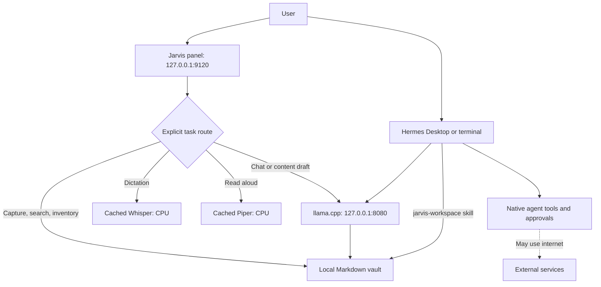

# Architecture

## Two connected surfaces



The panel is a sidecar, not a replacement Hermes agent. Its five model workflows call the same local llama.cpp server directly with no tools. This keeps the UI's jobs bounded and avoids inventing an undocumented Hermes chat API. Native Hermes still owns its conversations, memory system, tools, scheduling and approvals. The bridge is a plain-file vault and a skill that explains it.

## Inspiration translated into concrete choices

| Reference idea | Implementation | Reason |
| --- | --- | --- |
| Skills first | Five explicit workflow templates plus a Hermes vault skill | Useful outputs before complex UI orchestration |
| Persistent memory | raw/wiki/outputs Markdown folders | Inspectable, portable and compatible with Obsidian |
| Local voice | Existing Whisper and Piper engines | No second speech stack or cloud speech API |
| Request routing | Deterministic API routes and user-selected workflow | No unverified classifier or extra model required |
| Personalized UI | Small control panel for the actual workflows | No decorative system metrics presented as functionality |
| Team use | Reproducible kit only | Multi-user hosting is outside this single-user design |

No Jev service, Kokoro installation, wake word or model switching has been added. Those are not necessary for the installed local hardware. The routing is functional separation, not an ML classifier. There is one active model job; native Hermes and the panel can still contend for the same llama.cpp slot if used simultaneously.

## Source layout

```text
jarvis/core.py                  vault, loopback model client, job runner, templates
jarvis/server.py                protected local HTTP API and speech adapters
jarvis/static/                  UI, audio capture, print stylesheet
jarvis/skills/jarvis-workspace/  installed Hermes instructions
scripts/                       runtime discovery, install, launch, restore
tests/                         behavior and publication checks
docs/                          complete build and operating record
```

## Data and lifecycle

Runtime data lives under the active Hermes home, outside the repository:

```text
jarvis-data/settings.json       endpoint and model alias only
jarvis-data/vault/VAULT.md      folder map
jarvis-data/vault/raw/          captured material
jarvis-data/vault/wiki/         organized references
jarvis-data/vault/outputs/      generated drafts
backups/jarvis-*/manifest.json  local rollback snapshot, potentially sensitive
```

Source notes are read only when selected (up to five, first 6,000 characters each). The prompt is capped at 12,000 characters. Job responses have a 2 MB HTTP response limit and a ten-minute socket timeout; output notes have a 100,000-character limit. Jobs retain the latest 100 status records in RAM. Restarting the panel loses active/status records; completed Markdown outputs remain. There is no unattended scheduler or replay of incomplete jobs.

All timestamps stored in notes are UTC ISO dates. The UI does not pretend to provide news, calendar access, or durable autonomous task execution. A model draft is marked as a draft even if it sounds confident.

## Local model client

`LocalModel` accepts only literal `http://127.0.0.1:PORT/v1` endpoints, rejects credentials and URL query fragments, and uses `http.client` directly. It does not consult proxy environment variables, follow redirects or use API-key discovery. Its only model operations are `/v1/models` and `/v1/chat/completions`.

## HTTP interface

| Route | Purpose |
| --- | --- |
| GET / | Local UI and per-process session token |
| GET /api/status | Model availability, speech dependencies and vault path |
| GET /api/notes?q= | Local note search |
| GET /api/note?path= | Read a bounded vault note |
| GET /api/brief | Deterministic inventory |
| POST /api/notes | Create a new note |
| POST /api/jobs | Submit one tool-free model job |
| GET /api/jobs/id | Poll status and result |
| POST /api/transcribe | PCM16 mono 16 kHz WAV to local Whisper |
| POST /api/speak | Text to local Piper WAV |
| POST /api/print | Escaped printable HTML representation |
| POST /api/hermes | Launch the existing local Desktop script, with no user-supplied command |
| POST /api/shutdown | Stop this panel; preserve vault and separate model server |

API routes require an unguessable per-process header token. The Host header must match the literal loopback authority; POST requests with a different Origin fail. No cross-origin access headers are emitted. A content-security policy blocks external UI resources, frames and network connections. This is protection against browser-origin attacks, not malicious local programs.
